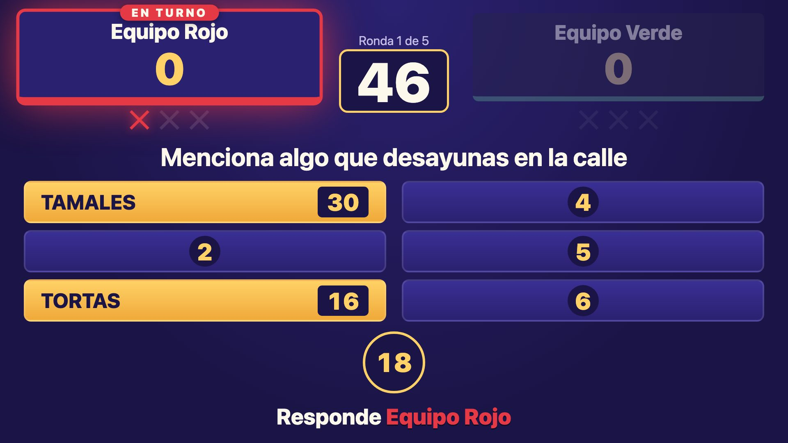
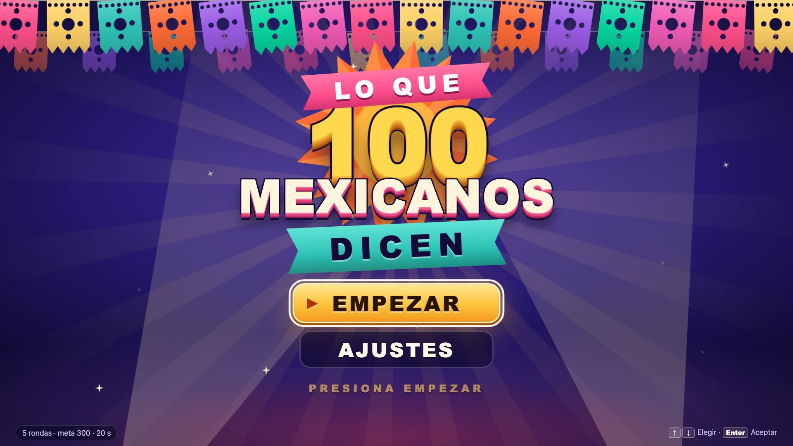
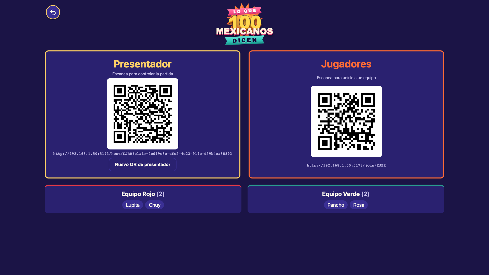
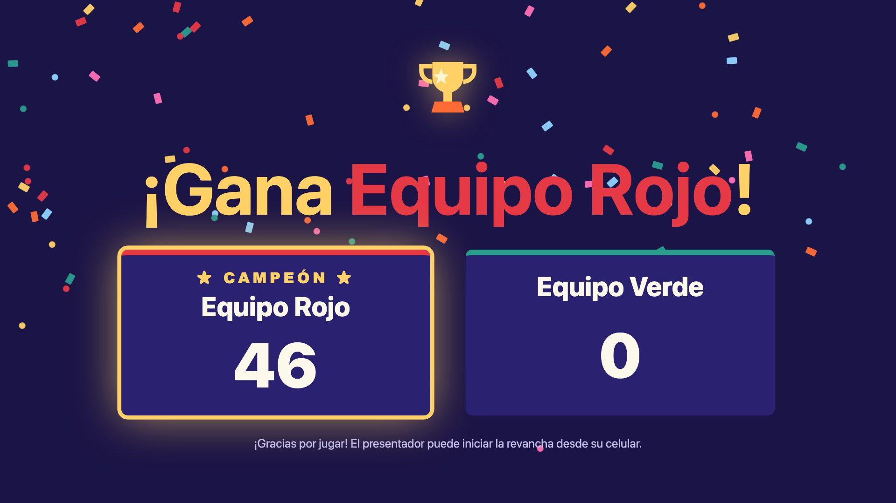
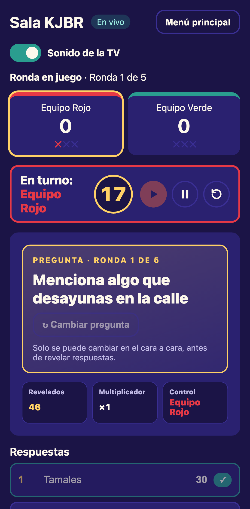
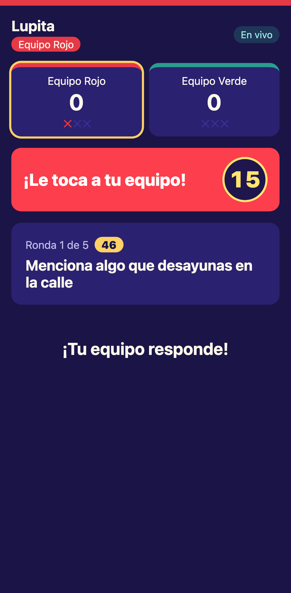
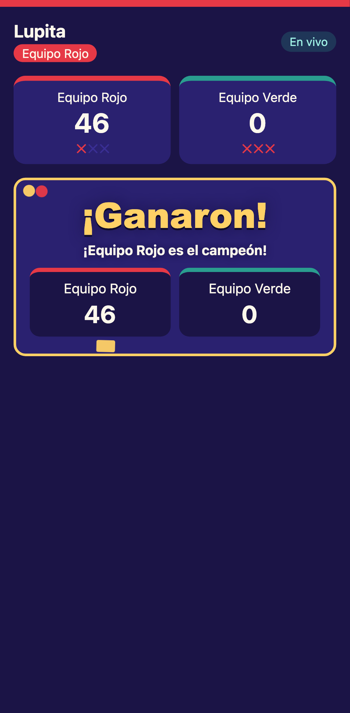

<div align="center">

# 🎤 Lo que 100 Mexicanos dicen

**El juego de encuestas por equipos para la sala de tu casa: la TV es el tablero, un celular es el presentador y todos los demás juegan desde el suyo.**

[](https://github.com/maycuca/02_100MexicanosDicen)
[](https://openjdk.org/)
[](https://spring.io/projects/spring-boot)
[](https://react.dev/)
[](https://vite.dev/)
[](https://sqlite.org/)

[](#-calidad)
[](#-calidad)
[](#-calidad)
[](#-privacidad-y-red-local)

<br>



</div>

---

## ✨ Qué puedes hacer

| | |
|---|---|
| 📺 **Convertir tu TV en el tablero** | Respuestas ocultas que se voltean, puntos en juego, la X gigante de cada equipo, la cuenta regresiva y sonidos de programa de concurso. |
| 📱 **Entrar escaneando un QR** | Sin cuentas ni apps: cada quien escanea el QR de **Jugadores**, escribe su nombre y elige **Equipo Rojo** o **Equipo Verde**. |
| 🎙️ **Conducir desde tu celular** | El presentador ve todas las respuestas, las revela, marca fallos y X, controla el temporizador (▶ ❚❚ ↺) y puede **cambiar la pregunta** si ya salió. |
| 🔔 **Ganar el buzzer** | En el cara a cara, el más rápido aprieta **¡YO!** en su celular. El celular vibra cuando le toca a tu equipo. |
| 🏆 **Festejar al final** | Confeti, trofeo, marcador que cuenta hasta el puntaje final y música de fiesta. Cada celular dice si su equipo ganó. |
| 🏷️ **Ponerle nombre a tu equipo** | El primero que entra a cada equipo es el **capitán** y elige el nombre. |
| 🧪 **Probar sin celulares** | Con **Prueba local** juegas todo en pestañas de una sola computadora. |
| ❓ **100 preguntas** | Cine, música, tele, fiestas, comida, deportes y frases de todos los días, todas originales. |

## 🖼️ Capturas

<table>
  <tr>
    <td width="50%"></td>
    <td width="50%"></td>
  </tr>
  <tr>
    <td align="center"><b>Pantalla de título de videojuego</b></td>
    <td align="center"><b>Escanea y únete a un equipo</b></td>
  </tr>
  <tr>
    <td colspan="2"></td>
  </tr>
  <tr>
    <td colspan="2" align="center"><b>Resultados de fiesta</b></td>
  </tr>
</table>

<table>
  <tr>
    <td align="center" width="33%"></td>
    <td align="center" width="33%"></td>
    <td align="center" width="33%"></td>
  </tr>
  <tr>
    <td align="center"><b>El presentador lo controla todo</b></td>
    <td align="center"><b>¡Le toca a tu equipo!</b></td>
    <td align="center"><b>¡Ganaron!</b></td>
  </tr>
</table>

> El diseño es de **fiesta mexicana**: papel picado, colores vivos, letras grandes con relieve y un tablero pensado para leerse desde el sillón. El logotipo, los sonidos y la música son originales y se generan en el navegador.

## 🎮 Cómo se juega

1. **Cara a cara.** Un jugador de cada equipo compite por el buzzer.
   - Si el equipo del buzzer abre la **#1**, se queda con el turno.
   - Si abre otra o se le acaba el tiempo, el otro equipo tiene su oportunidad: gana el turno si abre una respuesta **más alta**, y si falla, el turno regresa al primero.
2. **Tres X.** El equipo en turno intenta abrir todo el tablero antes de su tercera X.
3. **Robo.** Con tres X, el otro equipo tiene **una** oportunidad: si acierta, se roba los puntos; si falla, se los queda el equipo de las tres X.
4. **Final.** Las dos últimas rondas valen **doble** y **triple**. Gana quien llegue a la meta o tenga más puntos al terminar.

## 🚀 Empezar

**Requisitos:** Java 25, Node.js 22 o superior, y la laptop y los celulares en la **misma red Wi-Fi**.

```bash
git clone https://github.com/maycuca/02_100MexicanosDicen.git
cd 02_100MexicanosDicen

# Terminal 1: backend en :8080
cd backend && ./mvnw spring-boot:run

# Terminal 2: frontend en :5173 (visible en tu red)
cd frontend && npm install && npm run dev
```

Abre **http://localhost:5173** en la laptop conectada a la TV, pulsa **EMPEZAR** y escaneen los QR con sus celulares. 🎉

<details>
<summary><b>¿Tienes otra versión de Java por defecto?</b></summary>

En macOS selecciona el JDK 25 antes de arrancar el backend:

```bash
export JAVA_HOME=$(/usr/libexec/java_home -v 25)
```
</details>

<details>
<summary><b>Los QR apuntan a una IP equivocada</b></summary>

Si la laptop tiene varias redes, indica la IP de tu Wi-Fi al arrancar el backend:

```bash
./mvnw spring-boot:run -Dspring-boot.run.arguments=--app.lan-address=192.168.x.y
```
</details>

<details>
<summary><b>Probar sin celulares</b></summary>

En **AJUSTES** pon **Prueba local** en **Sí** y pulsa **EMPEZAR**. En lugar de los QR verás las URL con **Copiar** y **Abrir en pestaña nueva**. Cada pestaña es una sesión distinta, así que en una sola computadora puedes tener la TV, el presentador y varios jugadores.
</details>

<details>
<summary><b>Ajustes de la partida</b></summary>

| Ajuste | Opciones | Por defecto |
|---|---|---|
| Rondas | 3 a 8 | 5 |
| Meta de puntos | 50 a 1000 | 300 |
| Temporizador | sin temporizador o de 10 a 60 s | 20 s |
| X automática | marca una X cuando se acaba el tiempo | Sí |
| Sonido | sonidos y música en la TV | No |
| Prueba local | jugar en pestañas de una sola computadora | No |

Se guardan en el navegador de la TV.
</details>

## 🔒 Privacidad y red local

- **Todo se queda en tu casa.** El juego corre en tu laptop y en tu Wi-Fi: no necesita internet, cuentas ni servicios externos.
- **Nadie hace trampa.** La TV y los celulares de los jugadores nunca reciben el texto de las respuestas ocultas; solo el presentador ve el tablero completo.
- **QR de presentador de un solo uso.** Si alguien más lo escanea, ya no sirve. En la pantalla de QR de la TV se puede generar uno nuevo.
- **Salas temporales.** Las partidas viven en memoria y se cierran tras 2 horas sin actividad o cuando el presentador regresa al **Menú principal**; entonces cada celular borra su sesión.
- La base SQLite local (`backend/data/`) guarda el banco de preguntas y el historial de partidas, y nunca se sube al repositorio.

## 🧱 Arquitectura

```
02_100MexicanosDicen/
├── backend/    Java 25 · Spring Boot 4 · STOMP sobre WebSocket · SQLite + Flyway
├── frontend/   React 19 · TypeScript · Vite 8 · React Router · Web Audio
├── specs/      Constitución y especificaciones 001–008: la fuente de verdad
├── postman/    Colección de pruebas del contrato
└── docs/img/   Capturas de este README
```

- **El servidor es el árbitro.** Las reglas viven en `backend/…/game/domain` (código puro, sin framework). Los clientes solo muestran el estado que reciben.
- **Tiempo real.** Cada cambio se publica por STOMP con un número de versión, así la TV y los celulares nunca muestran un estado viejo.
- **Contrato primero.** La API está descrita en [OpenAPI](specs/001-juego-base/contracts/openapi.yaml) y los mensajes en [AsyncAPI](specs/001-juego-base/contracts/asyncapi.yaml); los tipos del frontend se generan de ahí.
- **Sonido sin archivos.** Los efectos, el júbilo del público y la música final se sintetizan con Web Audio, así que funcionan sin internet.

## ✅ Calidad

| Módulo | Comando | Resultado |
|---|---|---|
| Backend | `./mvnw verify` | 229 pruebas ✓ |
| Backend | `./mvnw verify -Pacceptance` | 219 pruebas de aceptación (HTTP + STOMP) ✓ |
| Frontend | `npm test` | 145 pruebas ✓ |
| Frontend | `npm run e2e` | 34 pruebas de partida completa (TV + presentador + jugadores) ✓ |
| Frontend | `npm run lint` · `npm run build` | sin avisos ✓ |
| Contrato | colección Postman | 122 peticiones, 0 fallos ✓ |

Cada criterio de aceptación está ligado a sus pruebas en el `traceability.md` de su especificación.

## 🛠️ Cómo se construyó

El proyecto sigue **desarrollo guiado por especificaciones (SDD)**. Primero se escriben la [constitución](specs/constitution.md) y la especificación de cada feature en [`specs/`](specs): historias, criterios de aceptación y contratos. Después las implementan agentes de [Claude Code](https://claude.com/claude-code) especializados (`backend-dev`, `frontend-dev` y `qa-tester`, en [`.claude/agents/`](.claude/agents)), coordinados según [`CLAUDE.md`](CLAUDE.md).

| Spec | Qué agregó |
|---|---|
| [001](specs/001-juego-base/spec.md) | Juego base: salas, QR, buzzer, tablero, robo y revancha |
| [002](specs/002-experiencia-de-juego/spec.md) | Equipo en turno, X por equipo, temporizador, sonidos y vibración |
| [003](specs/003-pantalla-de-titulo/spec.md) | Pantalla de título de videojuego y capitanes que nombran a su equipo |
| [004](specs/004-prueba-local/spec.md) | Prueba local en pestañas, sin celulares |
| [005](specs/005-control-del-presentador/spec.md) | Temporizador manual, júbilo y regresar al menú principal |
| [006](specs/006-reglas-cara-a-cara/spec.md) | Cara a cara automático |
| [007](specs/007-celebracion-y-cierre/spec.md) | Resultados de fiesta y "¡Gracias por jugar!" |
| [008](specs/008-pregunta-del-presentador/spec.md) | Pregunta destacada y "Cambiar pregunta" |

## 🗺️ Lo que viene

- Probar la partida con celulares reales en distintas redes (sonido en Safari de iOS y vibración en Android).
- Más preguntas: se agregan con una nueva migración en `backend/src/main/resources/db/migration/`.

---

<div align="center">
<sub>Hecho con ☕ y mucha fiesta por <a href="https://github.com/maycuca">@maycuca</a></sub>
</div>
